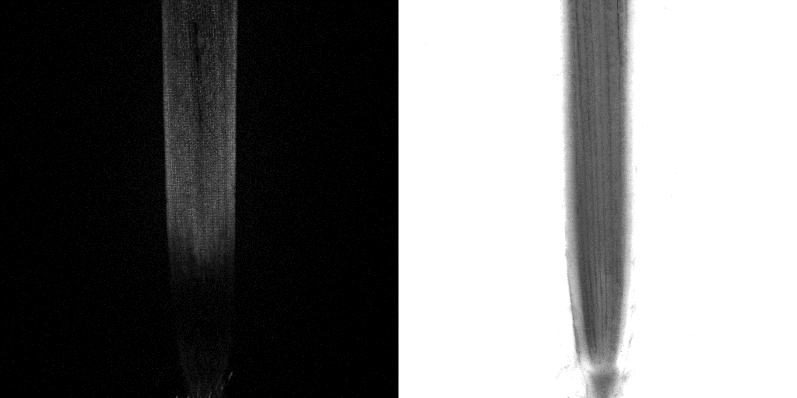
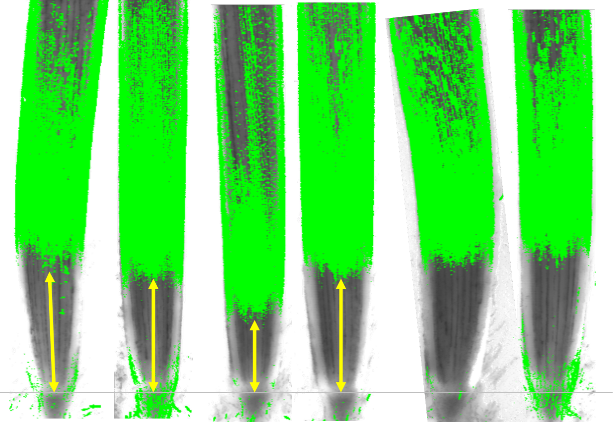

# <b>BES&ndash;H2O2&ndash;Ac</b>

Hydrogen peroxide ( H2O2 ) detection probe.

> Manufacturer : <a href='https://labchem-wako.fujifilm.com/us/product/detail/W01W0102-1781.html'>Wako</a>  
> Molecular Formula : C28H11F7O8S  
> M.W. = 640.44 g / mol

# Procedure

## **Step 1: Prepare stock solution ( 10 mM )**

Dissolve <b style='color: darkorange'>1 mg</b> of BES&ndash;H2O2&ndash;Ac powder in <b style='color: darkorange'>156.2 <i>&mu;</i>L DMSO</b> to form a 10 mM stock solution. Store at room temperature, must be <b style='color: red'>protected from light</b>.

## **Step 2: Stain**

### <b style='color: purple'>Short time incubation</b>

Dilute to <b style='color: purple'>10 - 50 <i>&mu;</i>M</b> with growth medium. Incubate at room temperature for &approx; 20 mins, protected from light.

### <b style='color: violet'>Long time incubation</b>

1. Make medium contains <b style='color: violet'>100 nM</b> BES-H2O2-Ac. 

- Add <b style='color: violet'>4 <i>&mu;</i>L</b> of 10 mM stock solution to <b style='color: violet'>400 mL</b> medium before the medium solidified ( ~ 50&deg;C ), mix thoroughly, must be protected from light.

2. Grow the plant on this medium for &approx; 6 days, cut the root and observe using confocal microscope.

  Before mounting the root onto the slide, gently remove the root cap by rubbing the root tip with tissue paper. This will make the quiescent center (QC) easier to identify.

## **Step 3: Confocal parameters**

| Parameters                                               | Theoretical value | Our machine                 |
|:-------------------------------------------------------- |:-----------------:|:--------------------:       |
| Excitation peak                                          | 485 nm            | 488 nm                      |
| Emission peak                                            | 515 nm            | 505 ~ 541 nm                |
| Magnification                                            |                   | 5X                          |
| Laser intensity ( <b style='color: #97ed1d'>488 nm</b> ) |                   | 20.0%                       |       
| Master Gain ( <b style='color: #97ed1d'>488 nm</b> )     |                   | 700 V                       |
| Master Gain ( <b style='color: #686e79'>T-PMT</b> )      |                   | 240 V                       |
| Digital Gain                                             |                   | 1.0                         |
| Pinhole                                                  |                   | &approx; 35 <i>&mu;</i>m |
| Z-stack interval                                         |                   | 16 <i>&mu;</i>m          |
| Scan speed                                               |                   | 6                           |
| Scan direction                                           |                   | <b>&xharr;</b>              |
||||

## **Step 4: Image processing**

1. Open the CZI file with ImageJ, view stack with `Hyperstack`.

2. Generate BES and T-PMT layers

- Repeat this process twice to generate both the BES and T-PMT layers:
- `Image` &xrarr; `Stacks` &xrarr; `Z Project...` &xrarr; Projection type: `Max intensity` &xrarr; `File` &xrarr; `Save As` &xrarr; `Tiff...`

3. Generate stacks

- Load in the previously generated BES and T-PMT TIFF files.
- `Image` &xrarr; `Stacks` &xrarr; `Images to Stack`

4. Measure distance

- Measure the distance between root tip and the BES signal distal boundary. The root tip can be easily recognized in the T-PMT layer.

 
<h2 style="text-align: center">Done !!!</h2>

## **Example image**

<!-- <figure style="display: flex; gap: 0px; align-items: flex-start; margin: 0;">
  

      
  

  

      
  

</figure> -->

<!-- 
Figure 1. BES-H2O2-Ac emission signal (left) and T-PMT image (right). The H2O2 signal was detected near the proximal site of the root (above elongation zone). Sometimes, at the root distal site (meristematic zone), strong H2O2 signal could also be detected because of root cap residuals.
 -->

<figure style="text-align: left; margin: 0;">
    
    <figcaption style="margin-top: 6px; text-align: justify;">
        Figure 1. BES-H2O2-Ac emission signal (left) and T-PMT image (right). The H2O2 signal was detected near the proximal site of the root (above elongation zone). Sometimes, at the root distal site (meristematic zone), strong H2O2 signal could also be detected because of root cap residuals.
    </figcaption>
</figure>

 

<figure style="text-align: left; margin: 0;">
    
    <figcaption style="margin-top: 6px; text-align: justify;">
        Figure 2. Stacked image of BES-H2O2-Ac and T-PMT image. The gray horizontal line represent the QC position of the root tip. The yellow vertical arrows represent the distance between the QC and the distal boundary of the BES signal. The BES signal had been binarized.
    </figcaption>
</figure>

 

If you encounter any issues with the protocol, please report them at:  
[https://github.com/P10911004-NPUST/jklai/issues](https://github.com/P10911004-NPUST/jklai/issues).