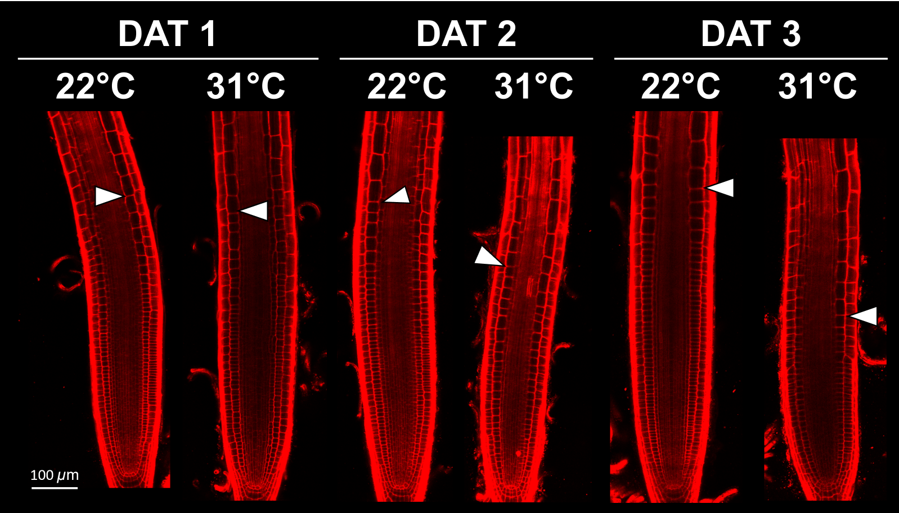

# Propidium Iodide (PI) staining

- **Intact cell membrane**: Propidium iodide (PI) cannot readily penetrate an intact cell membrane. Therefore, PI fluorescence remains outside the cell, allowing the cell boundary to be identified.
- **Damaged cell membrane**: When the cell membrane is damaged, PI can enter the cell and bind to nucleic acids in the nucleus, resulting in strong, localized PI signals that appear as bright blobs.
- **Prolonged treatment**: Extended exposure to PI may also lead to PI uptake by cells with initially intact membranes, potentially resulting in intracellular PI signals.

### <a href="https://www.sigmaaldrich.com/TW/en/product/sigma/p4170">Propidium Iodide (Sigma-Aldrich, Cas No. P4170)</a>

| Chemical         | M.W. (g/mol)    | Stock conc.  | Working conc.   | Location    |
| :------          | :---:           | :---:        | :---:           | :---:       |
| Propidium iodide | 668.39          | 1.5 mM       | 15 <i>&mu;</i>M | 4&deg;C (a) |
||||||

- **Stock solution ( 1.5 mM )**: Dissolve <b style='color: darkorange'>1 mg / mL</b> in ddH2O, stored at <b style='color: darkorange'>4&deg;C</b>, <b style='color: darkorange'>protected from light</b>.

- **Working solution ( 15 <i>&mu;</i>M )**: Dilute 10 &mu;L stock in 1 mL ddH2O ( so the working concentration is 10 &mu;g / mL ), stored at <b style='color: darkorange'>4&deg;C</b>, <b style='color: darkorange'>protected from light</b>.

- The stock ( 1 mg / mL ) and working solution ( 10 &mu;g / mL ) are also located at 4&deg;C (a).

## **Confocal parameter**

| Parameters                   | Theoretical value | Our machine              |
|:---------------------------- |:-----------------:|:--------------------:    |
| Excitation peak              | 493 nm            | 506 nm                   |
| Emission peak                | 636 nm            | 530 ~ 700 nm             |
| Magnification                |                   | 10X                      |
| Laser intensity              |                   | 16.0%                    |     
| Master Gain                  |                   | 700 V                    |
| Digital Gain                 |                   | 1.0                      |
| Pinhole                      |                   | &approx; 32 <i>&mu;</i>m |
| Z-stack interval             |                   | 4 <i>&mu;</i>m           |
| Scan speed                   |                   | 6                        |
| Scan direction               |                   | <b>&xharr;</b>           |
||||

> Not binding to DNA &rarr; Excitation / Emision maxima: 493 / 636 nm  
> After binding to DNA &rarr; Excitation / Emission maxima: 535 / 617 nm

## **Example image**

<figure style="text-align: left; margin: 0;">
    
    <figcaption style="margin-top: 8px;">Figure 1. Confocal laser scanning microscopy images of <i>Arabidopsis thaliana</i> roots stained with propidium iodide.</figcaption>
</figure>

 

If you encounter any issues with the protocol, please report them at:  
[https://github.com/P10911004-NPUST/jklai/issues](https://github.com/P10911004-NPUST/jklai/issues).
