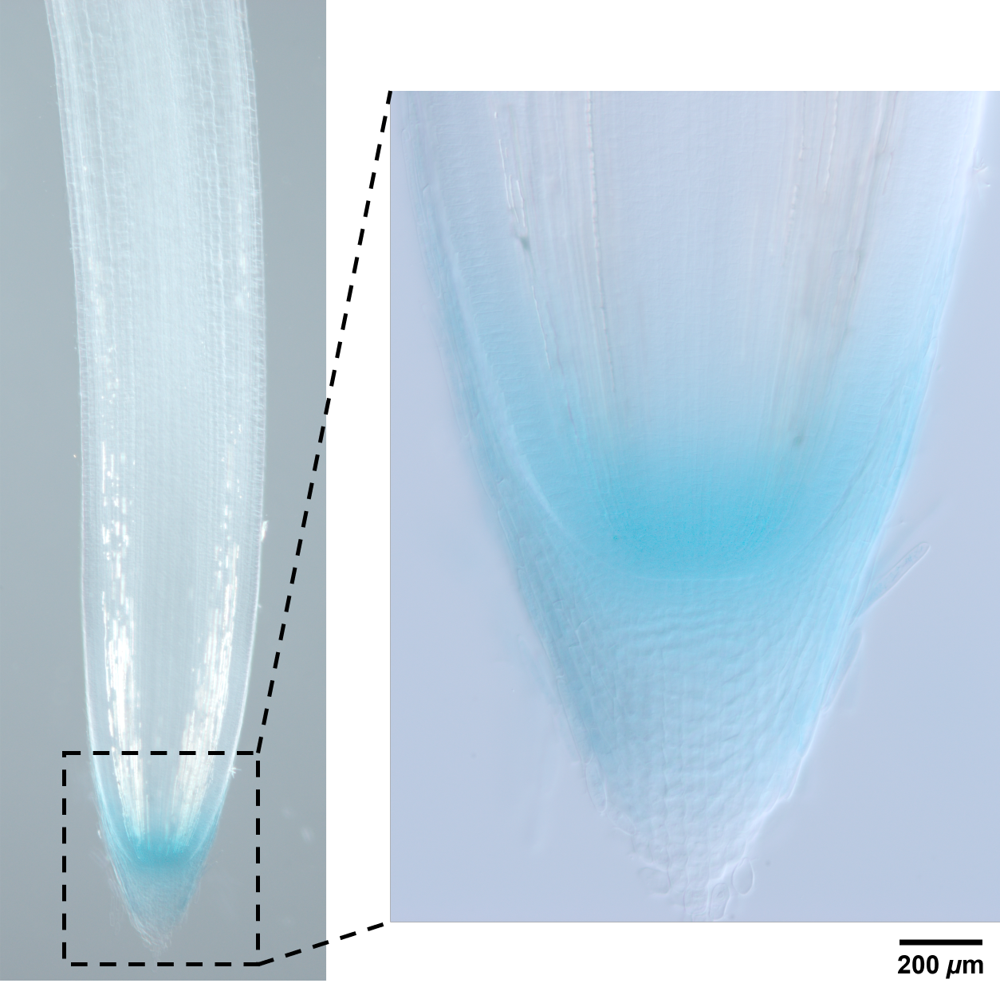

# **GUS staining**

X-GlcA, buy from [CyrusBioscience](http://cyrusbio.com.tw/webc/html/product/show.php?num=260&page=1&kw=X-Gluc)
> IUPAC name: 5-Bromo-4-chloro-1H-indol-3-yl β-D-glucopyranosiduronic acid  
> Other name: 5-Bromo-4-chloro-3-indolyl-β-D-glucuronide
> Molucular formula: C14H12BrClNO7Na  
> Molecular weight: 444.6 g/mol

# Procedure

## **Step 1: Prepare sodium phosphate buffer**

50 mM, pH 7.0  
<a href='https://www.novoprolabs.com/tools/buffer-preparations-and-recipes/sodium-phosphate-buffer'>Calculator</a>

| Chemical                       | M.W. (g/mol) | Addition  | Storage location |
| :---                           | :---:        | :---:     | :---:            |
| NaH2PO4  | 119.98       | 249.0 mg  | &#8546;          |
| Na2HPO4  | 141.96       | 414.0 mg  | &#8546;          |
| ddH2O               |              | 100 mL    |                  |
|||||

## **Step 2: Prepare X-GlcA stock solution (100 mM)**

Dissolve 444.6 mg of X-GlcA in 10 mL <b style='color: violet;'>N,N-Dimethylformamide (DMF)</b> or DMSO. 
I keep the stock solution in &minus;20&deg;C JK's white box. Must be <b style='color: red;'>protected from light</b>.

| Chemical  | M.W. (g/mol) | Addition  | Storage location               |
| :---      | :---:        | :---:     | :---:                          |
| X-GlcA    | 444.60       | 444.6 mg  | &minus;20&deg;C JK's white box |
| DMF       |              | 10 mL     | Toxic (D)                      |
|||||

## **Step 3: Prepare GUS stain working solution**

The working solution must be fresh-made and use immediately after prepared.

> 1 mM X-Gluc  
> 50 mM sodium phosphate buffer (Na-P) (pH 7.0)  
> 7% methanol  
> 0.1% TritonX-100

| Chemical                                 | Concentration  | Addition |  Storage location  |
| :---                                     | :---:          | ----:    | :---:              |
| X-GlcA stock solution&dagger; | 100 mM         | 1 mL     | &minus;20&deg;C    |
| Methanol                                 | 100%           | 7 mL     | Toxic (D)          |
| TritonX-100                              | 100%           | 1 drop   | II                 |
| Sodium phosphate buffer ( pH 7.0 )       | 50 mM          | 92 mL    |                    |
|||||

&dagger; The stock solution is stored in the door compartment of the &minus;20&deg;C freezer in a black 10 mL tube.

## **Step 4: GUS Stain**

1. Fully immersed the rice seedling in the GUS stain solution;

2. Vacumm infiltration on ice for 30 mins to allow the solution completely penetrate into the tissue;

3. Incubate at 37&deg;C in dark for 1&ndash;5 mins.

> - Incubation time may range from 1 min to 24 hours, depend on the organ/tissue type.
> - For the QC region in root tip, &ge;5 mins will easily overstained.

4. Rinse with water to fully wash out the stain solution.

> - For leaf, rinse with 75% or 95% ethanol until the chlorophyll was bleached.

5. Observe under a light microscope.

 

<h2 style="text-align: center">Done !!!</h2>

## **Example image**

<figure style="text-align: left; margin: 0;">
    
    <figcaption style="margin-top: 8px;">Figure 1. GUS staining of a rice root tip.</figcaption>
</figure>

 

If you encounter any issues with the protocol, please report them at:  
[https://github.com/P10911004-NPUST/jklai/issues](https://github.com/P10911004-NPUST/jklai/issues).